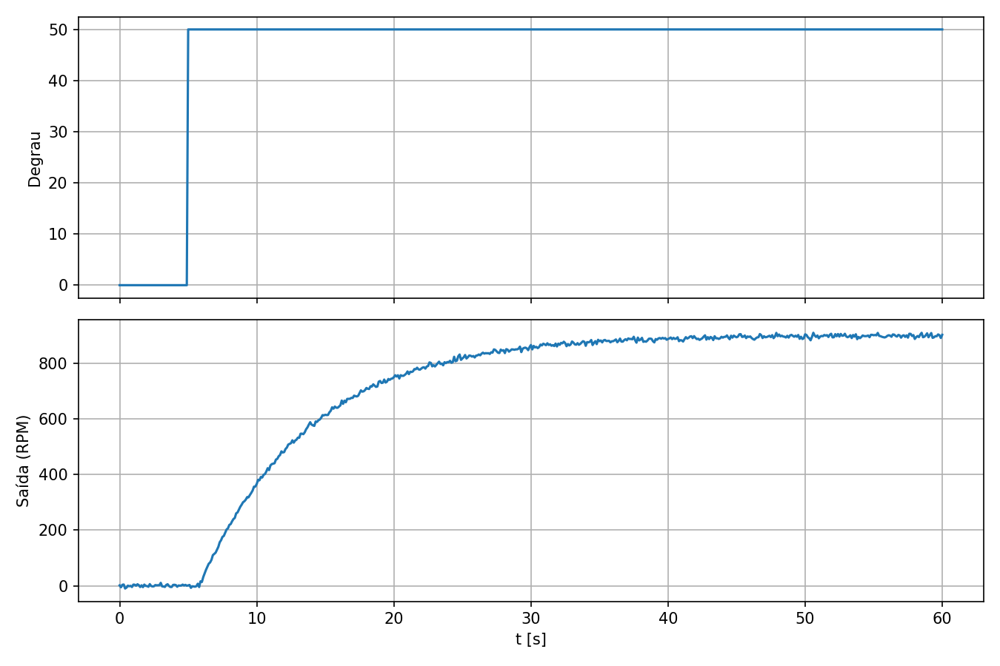
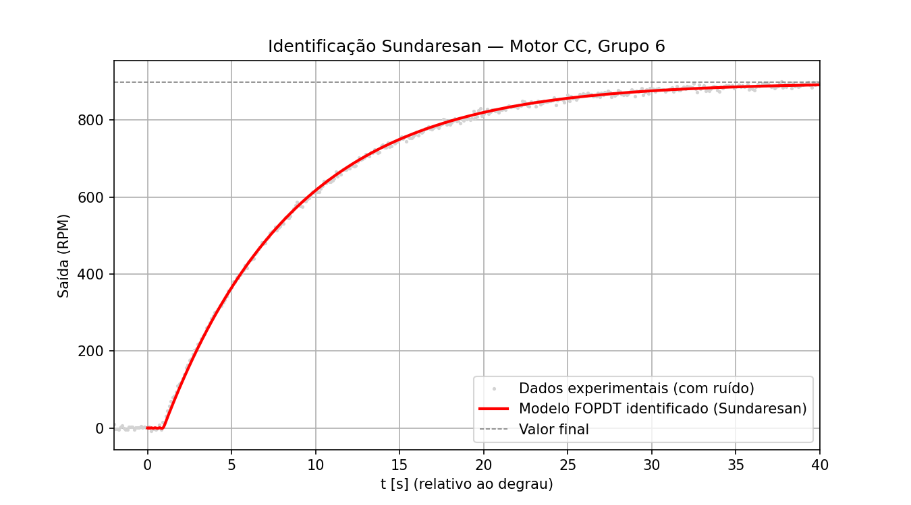
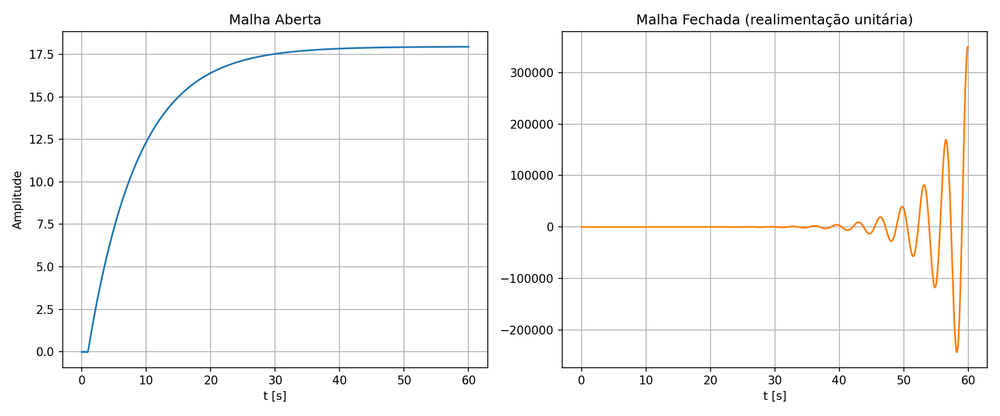
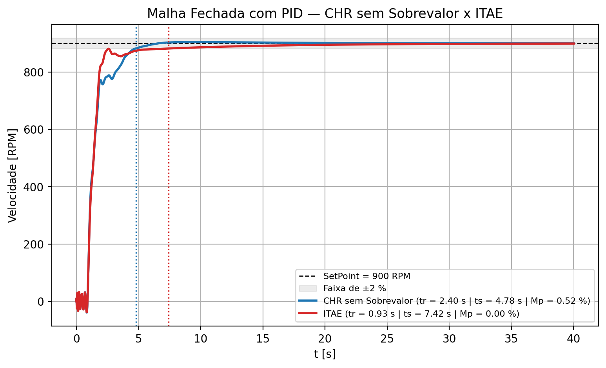

# Trabalho PID

### Contribuidores
- Gustavo Pivoto Ambrósio
- Marcelo Fróes Padilha Filho
- Miguel Vianna Streva

### Professor
- Samuel Baraldi Mafra

### Monitor
- Lucas Henrique Ribeiro

## Parte teórica do trabalho

### 1. Funcionamento da planta

A planta consiste em um motor de corrente contínua (CC), cujo objetivo é controlar sua velocidade de rotação utilizando um controlador PID.

O controle é realizado através de um sinal PWM (Pulse Width Modulation), que permite variar a tensão média aplicada ao motor e, consequentemente, sua velocidade. O controlador PID compara a velocidade atual do motor com o valor desejado (SetPoint) e ajusta o PWM para reduzir o erro.

Em uma implementação real, poderiam ser utilizados os seguintes componentes:
- Sensor: encoder incremental, responsável por medir a velocidade de rotação do motor em RPM;
- Atuador: motor CC acionado por um driver de potência, que controla a energia fornecida ao motor;
- Controlador: microcontrolador, como STM32 ou ESP32, responsável por executar o algoritmo PID, ler o sensor e gerar o sinal PWM.

Dessa forma, o sistema funciona em malha fechada, ajustando continuamente a velocidade do motor para mantê-la próxima do SetPoint definido.

### 2. Variáveis do processo e faixas de operação

As variáveis envolvidas no controle de velocidade do motor CC são:
- Variável controlada: velocidade de rotação do motor, medida em RPM (é a grandeza que desejamos regular);
- Variável manipulada: duty cycle do sinal PWM, responsável por alterar a tensão média aplicada ao motor;
- SetPoint: velocidade desejada para o motor, definida pelo usuário;
- Perturbações: variações de carga mecânica no eixo, alterações na tensão de alimentação, atrito e mudanças de temperatura.

As faixas de operação são apresentadas na tabela abaixo:

| Grandeza | Faixa de operação |
| --- | --- |
| Velocidade do motor | 0 até a velocidade máxima nominal do motor |
| PWM | 0% a 100% |
| SetPoint | 0 até a velocidade máxima operacional |

## Parte prática do trabalho

### 1. Identificação do conjunto de dados

Os dados utilizados foram os do `Dataset Grupo6` (`Motor_G6.mat`), obtidos por um Ensaio da Curva de Reação. Um degrau de 50% é aplicado à entrada do motor em t = 5 s, e a velocidade de saída (RPM) é registrada ao longo de 60 s, com ruído de medição.



### 2. Escolha do método de identificação

Entre os métodos de Smith e Sundaresan, optou-se pelo método de Sundaresan, pois ele não depende de uma tangente no ponto de inflexão da curva, ao contrário do método de Smith, e é indicado para amostras com maior presença de ruído, característica presente neste dataset.

A partir dos instantes em que a resposta cruza 35,3% e 85,3% do valor final, foram obtidos os parâmetros do modelo FOPDT:

| Parâmetro | Valor |
| --- | --- |
| k (ganho estático) | 17,9516 RPM/% |
| τ (constante de tempo) | 7,7765 s |
| θ (atraso de transporte) | 0,9466 s |

### 3. Comparação entre resposta original e resposta estimada

O modelo foi construído em série com uma aproximação de Padé de ordem 10 para o atraso de transporte, e sua resposta ao degrau foi comparada com os dados experimentais:



A curva estimada acompanha de perto os dados reais, validando a identificação sem necessidade de ajuste fino adicional.

### 4. Malha aberta x Malha fechada

Comparando a resposta ao degrau unitário do modelo identificado em malha aberta e em malha fechada (realimentação unitária, sem controlador):



Em malha aberta, o sistema é estável e atinge o regime permanente suavemente, com y aproximadamente igual a k, sem erro, pois é apenas a resposta da planta ao degrau. Já em malha fechada sem controlador, o sistema diverge. O ganho estático elevado, k próximo de 18, combinado ao atraso de transporte, θ próximo de 0,95 s, leva a malha além do limite de estabilidade, e o sistema passa a oscilar com amplitude crescente. Não há, portanto, tr, ts ou erro de regime definidos nessa condição, o que evidencia a necessidade de um controlador PID devidamente sintonizado, tratado nas seções seguintes.

### 5. Sintonia do controlador PID

A sintonia do controlador PID foi realizada a partir do modelo FOPDT identificado pelo método de Sundaresan:

| Parâmetro | Valor |
| --- | --- |
| k (ganho estático) | 17,9516 RPM/% |
| τ (constante de tempo) | 7,7765 s |
| θ (atraso de transporte) | 0,9466 s |
| θ/τ (fator de incontrolabilidade) | 0,1217 |

Conforme a Tabela 7, o Grupo 6 utilizou as seguintes técnicas de sintonia:
- Técnica 3: CHR sem Sobrevalor (Tabela 3);
- Técnica 6: ITAE (Tabela 6).

Os parâmetros obtidos estão apresentados na Tabela 8:

| Técnica | Método | Kp | Ti [s] | Td [s] |
| --- | --- | --- | --- | --- |
| 3 | CHR sem Sobrevalor | 0,2746 | 7,7765 | 0,4733 |
| 6 | ITAE | 0,3220 | 9,9941 | 0,3386 |

Para a simulação, o atraso de transporte foi representado pela aproximação de Padé de ordem 10, e o PID foi implementado com filtro na ação derivativa (N = 10). O sistema em malha fechada foi simulado para um SetPoint de 900 RPM, obtendo os seguintes resultados:

| Método | Tempo de subida (tr) | Tempo de acomodação (ts, 2%) | Overshoot (Mp) | Erro em regime |
| --- | --- | --- | --- | --- |
| CHR sem Sobrevalor | 2,40 s | 4,78 s | 0,52% | 0 |
| ITAE | 0,93 s | 7,42 s | 0,00% | 0 |



Os dois controladores tornaram o sistema estável e eliminaram o erro em regime permanente, levando o motor à velocidade desejada de 900 RPM.

### 6. Análise do desempenho

O critério de desempenho definido para o Grupo 6 é o **menor tempo de resposta**.

Entre os métodos aplicados, o **CHR sem Sobrevalor** foi o mais adequado. Ele leva o motor ao regime permanente (faixa de ±2% do SetPoint) em 4,78 s, enquanto o ITAE leva 7,42 s, sendo aproximadamente 36% mais rápido.

O ITAE apresenta menor tempo de subida (0,93 s), pois possui ganho proporcional maior. Porém, após a subida, a velocidade se aproxima do SetPoint lentamente, pois seu tempo integral (Ti ≈ 9,99 s) é maior que a constante de tempo da planta, tornando a ação integral mais fraca.

No CHR sem Sobrevalor, o tempo integral é igual à constante de tempo (Ti = τ). Dessa forma, o zero do controlador cancela o polo da planta e o erro é eliminado rapidamente.

Além disso, o método CHR para o problema servo foi proposto justamente para obter a resposta mais rápida possível sem sobressinal diante de mudanças de SetPoint, o que coincide com o critério de desempenho do grupo. O pequeno overshoot obtido (0,52%) é desprezível.


### 7. Interface

Foi desenvolvida uma interface em Python para facilitar a análise do sistema. A interface permite:

- selecionar o método de sintonia do controlador;
- ajustar manualmente os parâmetros do PID;
- visualizar a resposta do sistema em malha fechada;
- comparar os métodos CHR e ITAE;
- carregar o dataset experimental para análise da planta;
- exportar o gráfico gerado.

### Como executar

1. Acesse a pasta `interface`.

2. Dentro dessa pasta, execute:
```bash
python -m venv .venv
```

3. Depois, ative o ambiente:
```bash
source .venv/bin/activate
```

4. Com o ambiente virtual ativado:
```bash
python -m pip install -r requirements.txt
```

5. Por fim, execute a interface:
```bash
python interface.py
```
